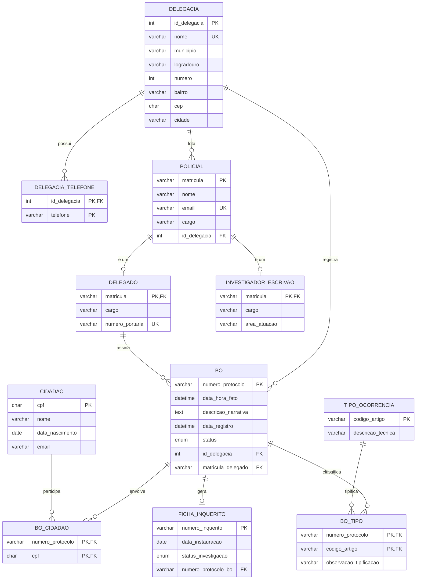

# Modelo Lógico – PoliceGOV (Sistema de Boletim de Ocorrências Estadual)

Notação: **PK** = chave primária · **FK** = chave estrangeira · UQ = único · NN = not null

## Mapeamento conceitual → lógico
| Elemento do DER | Regra aplicada | Resultado |
|---|---|---|
| Endereço composto da Delegacia | atributo composto vira colunas da própria tabela | logradouro, numero, bairro, cep, cidade |
| Telefones de plantão (multivalorado) | atributo multivalorado vira tabela própria | `delegacia_telefone` (PK composta) |
| Lota (Delegacia 1:N Policial) | FK no lado N | `policial.id_delegacia` |
| Especialização Policial → Delegado / Investigador-Escrivão | uma tabela por subclasse; PK da subclasse = PK da superclasse | `delegado`, `investigador_escrivao` |
| Disjunção da especialização | FK composta (matricula, cargo) + CHECK no cargo da subclasse | cada policial só entra no subtipo coerente com seu cargo |
| Registra (Delegacia 1:N BO) | FK no lado N | `bo.id_delegacia` |
| Assina (Delegado 1:N BO) | FK no lado N | `bo.matricula_delegado` |
| Envolve (Cidadão N:N BO) | tabela associativa | `bo_cidadao` (PK composta) |
| Classifica (BO N:N Tipo de Ocorrência) | tabela associativa com atributo próprio | `bo_tipo` (PK composta) |
| Gera (BO 1:1 Ficha de Inquérito) | FK com UNIQUE na ficha (participação total) | `ficha_inquerito.numero_protocolo_bo` |
| Idade do cidadão | atributo derivado, não vira coluna | calculada pela view `vw_idade_cidadao` |

## Esquema relacional
```
delegacia (PK id_delegacia, nome UQ NN, municipio NN, logradouro NN, numero NN,
           bairro NN, cep NN, cidade NN)

delegacia_telefone (PK id_delegacia, PK telefone,
                    FK id_delegacia -> delegacia [ON DELETE CASCADE])

policial (PK matricula, nome NN, email UQ NN, cargo NN,
          FK id_delegacia -> delegacia NN, UQ (matricula, cargo))

delegado (PK/FK matricula, cargo NN, numero_portaria UQ NN,
          FK (matricula, cargo) -> policial (matricula, cargo))

investigador_escrivao (PK/FK matricula, cargo NN, area_atuacao NN,
          FK (matricula, cargo) -> policial (matricula, cargo))

cidadao (PK cpf, nome NN, data_nascimento NN, email NN)

tipo_ocorrencia (PK codigo_artigo, descricao_tecnica NN)

bo (PK numero_protocolo, data_hora_fato NN, descricao_narrativa NN,
    data_registro NN, status NN,
    FK id_delegacia -> delegacia NN,
    FK matricula_delegado -> delegado (matricula) NN)

bo_cidadao (PK numero_protocolo, PK cpf,
            FK numero_protocolo -> bo [ON DELETE CASCADE],
            FK cpf -> cidadao)

bo_tipo (PK numero_protocolo, PK codigo_artigo, observacao_tipificacao,
         FK numero_protocolo -> bo [ON DELETE CASCADE],
         FK codigo_artigo -> tipo_ocorrencia)

ficha_inquerito (PK numero_inquerito, data_instauracao NN, status_investigacao NN,
                 FK numero_protocolo_bo -> bo UQ NN)
```

## Restrições CHECK e domínios
- `delegacia.numero > 0`
- `delegacia.cep` com 8 dígitos
- `delegacia_telefone.telefone` com 10 ou 11 dígitos
- `policial.cargo` ∈ {Delegado de Polícia, Investigador, Escrivão}
- `policial.email` e `cidadao.email` com formato `x@y.z`
- `policial.matricula` com 6 a 10 dígitos
- `delegado.cargo = 'Delegado de Polícia'`; `investigador_escrivao.cargo` ∈ {Investigador, Escrivão}
- `cidadao.cpf` com 11 dígitos
- `bo.data_registro >= bo.data_hora_fato`
- `bo.status` ∈ {Em Investigação, Concluído, Arquivado}
- `ficha_inquerito.status_investigacao` ∈ {Ativo, Relatado, Arquivado, Suspenso}
- `ficha_inquerito.data_instauracao >= '2000-01-01'`

## Diagrama (Mermaid)

